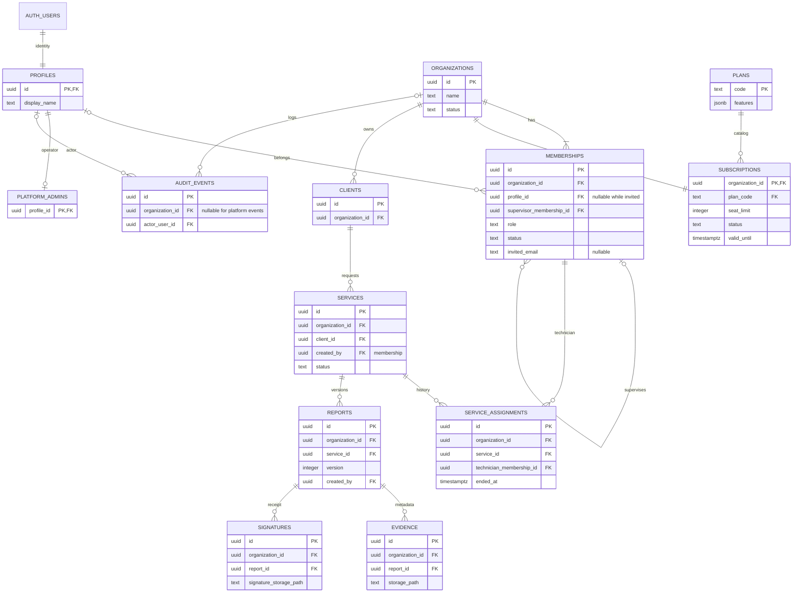

# Phase 1 ERD

UUID PKs unless otherwise shown. All child relationships below use RESTRICT, not
historical cascades. Tenant tables carry organization_id and unique (organization_id,
id), allowing composite FKs to prevent cross-tenant references.

The Phase 1 instruction authorizes implementation, not approval of every modeling
decision. This ERD was internally reviewed and implemented; human acceptance and
cloud replay remain pending. Full columns/constraints: DATABASE.md.
